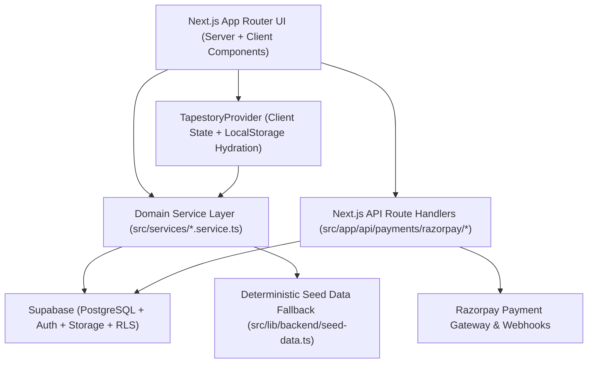

# System Architecture — Tapestory Customer Website

## 1. High-Level Architecture

Tapestory follows a layered, modular **Next.js 15 App Router** architecture with **Supabase** (PostgreSQL + Auth + Storage + Row-Level Security) as the primary backend and a deterministic local seed fallback (`src/lib/backend/seed-data.ts`) so the application runs with zero external latency in development, staging, or offline environments.

---

## 2. Architectural Layers

### A. Presentation Layer (`src/app/` & `src/components/`)
- **Route Groups:**
  - `(storefront)`: All customer-facing discovery, customization, 3D preview, measurement, cart, checkout, order tracking, and account management pages.
  - `(auth)`: Dedicated authentication screens (`/login`, `/signup`, `/forgot-password`).
- **Component Isolation:** Every reusable UI component in `src/components/` lives in its own named directory with `ComponentName.tsx`, `ComponentName.types.ts`, and `index.ts`.

### B. State & Domain Orchestration Layer (`src/features/store-provider.tsx`)
- Provides reactive client-side persistence across multi-step flows:
  - Active `GarmentConfiguration` across `/customize`, `/measurements`, `/customize/preview`, and `/customize/save`.
  - Saved `MeasurementProfile[]` with version history and default profile switching.
  - Shopping `CartItem[]`, coupon codes (`WELCOME10`, `FIRSTFIT`, `ATELIER500`), and shipping `Address[]`.
  - `Order[]`, `AlterationRequest[]`, `ReviewItem[]`, `NotificationItem[]`, and `SupportTicket[]`.

### C. Service Layer (`src/services/*.service.ts`)
- Decouples UI components from database specifics:
  - `product.service.ts` — Filtering, sorting, search, and slug lookup.
  - `vendor.service.ts` — Atelier profiles, ratings, and portfolios.
  - `customization.service.ts` — Default configuration builder and itemized price calculator.
  - `measurement.service.ts` — Unit conversion (`cm` ↔ `in`), validation, and profile formatting.
  - `order.service.ts` — Order lookup, timeline resolution, and post-purchase eligibility.
  - `payment.service.ts` — Client-side Razorpay checkout orchestration and verification calls.
  - `account.service.ts` — Customer profile management and preferences.

### D. Secure API & Backend Layer (`src/app/api/` & `backend/supabase/`)
- Server-only API routes handle sensitive secrets (`RAZORPAY_KEY_SECRET`, `RAZORPAY_WEBHOOK_SECRET`, `SUPABASE_SERVICE_ROLE_KEY`).
- Complete PostgreSQL schema with Row-Level Security policies is maintained in `backend/supabase/schema.sql`.
