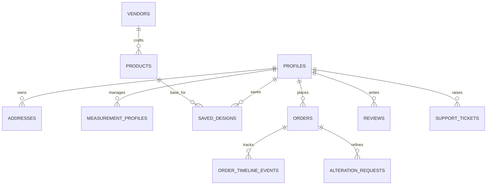

# Database Schema — Tapestory Customer Website

The complete PostgreSQL DDL and Row-Level Security (RLS) policy script is located at [`backend/supabase/schema.sql`](../backend/supabase/schema.sql).

## 1. Entity-Relationship Overview

---

## 2. Core Tables (`backend/supabase/schema.sql`)

| Table | Purpose | Key Columns |
| :--- | :--- | :--- |
| `public.profiles` | Customer profile linked to `auth.users(id)` | `id`, `full_name`, `email`, `phone`, `preferred_unit`, `preferred_fit`, `preferred_language` |
| `public.vendors` | Verified partner ateliers | `id`, `slug`, `name`, `location`, `specialty`, `rating`, `review_count`, `turnaround_days` |
| `public.products` | Base customizable garments | `id`, `slug`, `name`, `vendor_id`, `category`, `gender`, `base_price_inr`, `fabrics_json`, `colors_json` |
| `public.measurement_profiles` | Saved customer body measurements & version history | `id`, `user_id`, `name`, `gender_fit`, `unit`, `fit_preference`, `values_json`, `history_json`, `is_default` |
| `public.saved_designs` | Saved custom configurations & studio drafts | `id`, `user_id`, `product_id`, `name`, `collection_tag`, `status`, `configuration_json`, `estimated_price_inr` |
| `public.addresses` | Customer shipping & pickup addresses | `id`, `user_id`, `label`, `recipient_name`, `phone`, `line1`, `city`, `state`, `postal_code`, `is_default` |
| `public.orders` | Confirmed made-to-measure orders & payment audit | `id`, `order_number`, `user_id`, `status_category`, `current_stage`, `configuration_json`, `total_inr`, `razorpay_order_id`, `razorpay_payment_id` |
| `public.alteration_requests` | Post-delivery complimentary fit adjustment requests | `id`, `request_number`, `order_id`, `user_id`, `requested_areas`, `fit_adjustment_notes`, `status` |
| `public.reviews` | Verified product and vendor ratings & reviews | `id`, `order_id`, `user_id`, `review_type`, `target_id`, `rating`, `fit_accuracy_rating`, `craftsmanship_rating`, `status` |
| `public.support_tickets` | Customer care & order assistance tickets | `id`, `ticket_number`, `user_id`, `order_number`, `category`, `subject`, `description`, `status` |

---

## 3. Row-Level Security (RLS)

- **Public Read-Only Catalog:** `vendors`, `products`, and published `reviews` allow `SELECT` for all visitors (`anon` and `authenticated`).
- **Strict Tenant Isolation:** `profiles`, `measurement_profiles`, `saved_designs`, `addresses`, `orders`, `alteration_requests`, and `support_tickets` enforce `auth.uid() = user_id` on `SELECT`, `INSERT`, `UPDATE`, and `DELETE`.
