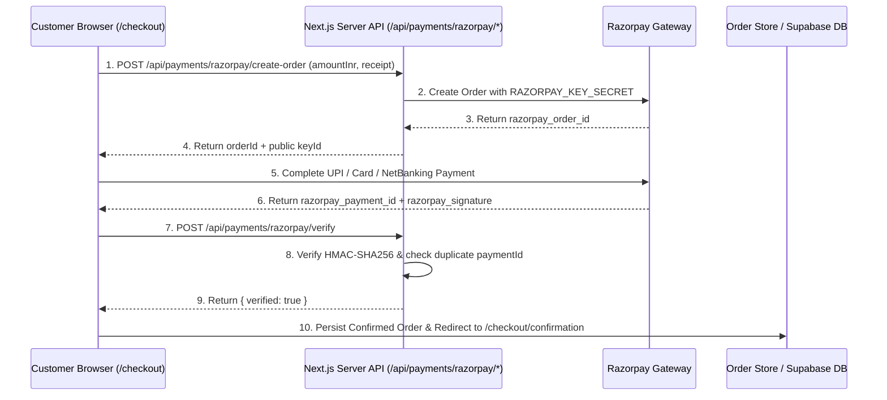

# Razorpay Payment Integration — Tapestory Customer Website

## 1. End-to-End Payment Flow

---

## 2. Security Safeguards Implemented

1. **Zero Secret Exposure on Client:**
   - `RAZORPAY_KEY_SECRET` and `RAZORPAY_WEBHOOK_SECRET` are strictly accessed inside server-side route handlers (`src/app/api/payments/razorpay/*/route.ts`).
2. **Cryptographic Signature Verification:**
   - `src/app/api/payments/razorpay/verify/route.ts` computes `crypto.createHmac("sha256", secret).update(`${orderId}|${paymentId}`).digest("hex")` and compares it using timing-safe equality.
3. **Duplicate Payment Prevention:**
   - Both the `/verify` endpoint and `/webhook` endpoint track processed payment IDs and event IDs in an idempotency set so network retries cannot double-charge or create duplicate orders.
4. **Simulated Development Mode:**
   - When `RAZORPAY_KEY_ID` and `RAZORPAY_KEY_SECRET` are not set in `.env.local`, the API routes automatically run in deterministic simulated mode so the entire `/cart` → `/checkout` → `/checkout/confirmation` flow can be tested end-to-end out of the box.
